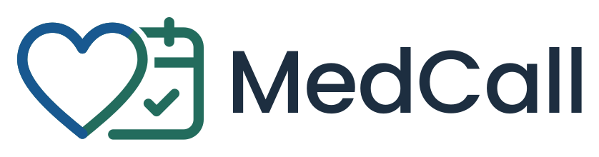

<div align="center">

## Idioma

[Português](README.md) · [English](README.en.md)




# MedCall

**Sua saúde na palma da mão.**

Aplicativo de pré-triagem informativa e agendamento de consultas. Projeto Integrador do 3º período de Análise e Desenvolvimento de Sistemas da Faculdade Senac Pernambuco.

Antes se chamava Recife Saudável. O nome do produto é MedCall.


> A MedCall não realiza diagnóstico médico e não substitui atendimento profissional. Em emergência, ligue 192 (SAMU). O texto está no componente `ClinicalDisclaimer`.

[Sistema no ar](https://medcall.grupotp.polyclub.com.br) · [Requisitos V8](https://grupotp.youtrack.cloud/articles/SPM-A-141) · [Protótipo no Figma](https://www.figma.com/make/HgsxSju4V0c9LixmfcUxm7/App-Recife-Saud%C3%A1vel-Development?fullscreen=1&t=qW8P0oS0T6RXnKZX-1&code-node-id=0-6) · [Pitch](https://www.canva.com/design/DAHb31ads88/bK-cDvsyY1i6zaBu8-vvZA/edit)

</div>

## O projeto, em poucas palavras

A pessoa abre o MedCall no celular ou no navegador. Cria uma conta, descreve o que está sentindo e escolhe especialidade, profissional e horário. A consulta fica salva. Se a internet cair, as consultas já marcadas continuam na tela. Marcar outra só funciona com conexão.

O aplicativo não diz qual é o problema de saúde e não substitui o profissional. Em emergência, o aviso da tela pede para ligar 192.

Na versão web, um botão de acessibilidade (AccessAbility Widget 2.3.1) permite ajustar contraste, tamanho da letra e leitura. O app Android usa a mesma interface, sem esse botão, porque ele vive no HTML da PWA.

## Testes executados

Última execução local em 24 de novembro de 2026, com o comando da seção [Como executar](#como-executar).

| Resultado | Quantidade |
|---|---|
| Testes executados | 128 |
| Falhas | 0 |
| Erros | 0 |
| Ignorados | 0 |

Os números saíram dos relatórios XML do Gradle, nas pastas de `common`, `server`, `client/app` e `client/worker`. Os testes de `common` entram duas vezes quando rodam na JVM e no JavaScript. A tabela registra essa execução. Ela não muda sozinha a cada commit.

## O que está neste repositório

A interface é Kotlin com React Native. O mesmo código roda como PWA no navegador e como app Android. O shell Expo em `medcall/client/expo` só registra o componente Kotlin. No navegador, o Metro troca `react-native` por `react-native-web`.

O servidor é Kotlin/JVM 21, com Ktor, Koin e Exposed. Em desenvolvimento e nos testes o banco é H2. Em produção é MySQL. A publicação é GitOps: imagens no ghcr.io, Kubernetes no namespace `medcall`, ArgoCD e Traefik.

O detalhe de módulos, offline, fuso da clínica e variáveis está em [medcall/README.md](medcall/README.md). Este arquivo é a capa do repositório.

## O que o aplicativo faz hoje

- Boas-vindas, cadastro e login.
- Pré-triagem informativa, sem diagnóstico.
- Agendamento em três etapas: especialidade e profissional, data e horário, confirmação.
- Consultas já marcadas visíveis sem internet. Agendar exige conexão. O servidor confere a vaga de novo, e um índice único impede dois agendamentos no mesmo horário.
- Conta: perfil, consentimento de notificações, troca de senha e pedido de exclusão.
- Tela de política de privacidade.

A pré-análise de risco por IA, no dashboard da clínica, está especificada e ainda não está neste código. Só clínica e profissional devem ver o nível. O paciente não. A decisão é do profissional. Fonte da especificação: [SPM-A-139](https://grupotp.youtrack.cloud/articles/SPM-A-139/Pre-analise-de-risco-Feita-por-AI). As normas do Ministério da Saúde e do CFM exigem acolhimento com classificação de risco e não impõem um protocolo único. Manchester entra como referência. [Publicação do Ministério da Saúde](https://bvsms.saude.gov.br/bvs/publicacoes/acolhimento_classificaao_risco_servico_urgencia.pdf).

## API

19 rotas em `/api/v1`. As de paciente exigem `Authorization: Bearer`. O token é um JWT HS256 (`JWT_SECRET`, no mínimo 32 bytes). O servidor guarda só o id da sessão e a revoga no logout.

| Área | Rotas |
|---|---|
| Auth | `POST /auth/register`, `POST /auth/login`, `GET /auth/me`, `POST /auth/logout` |
| Conta | `GET /account`, `PUT /account`, `PUT /account/consents`, `POST /account/password`, `POST /account/deletion-request` |
| Pré-triagem | `GET /pre-triages/draft`, `GET /pre-triages/pending`, `POST /pre-triages` |
| Agenda | `GET /specialties`, `GET /professionals`, `GET /clinics`, `GET /availability`, `GET /appointments`, `POST /appointments`, `POST /appointments/{id}/cancel` |

Fora da API: `GET /healthz` (processo no ar, sem consultar o banco) e `GET /readyz` (banco respondendo).

Senha com PBKDF2-HMAC-SHA256, 600.000 iterações. Fonte do formato: [medcall/README.md](medcall/README.md).

## Arquitetura

```text
Cliente Kotlin/JS + React Native (PWA e Android)
        |
        | REST /api/v1
        v
Servidor Ktor
  controller  ->  service  ->  repository (Exposed)
        |
        v
H2 no desenvolvimento, MySQL na produção
```

A regra de negócio fica no service. O controller recebe a requisição e devolve a resposta.

## Onde está o código

```text
medcall/
  common/          compartilhado, JVM e JavaScript
  server/          Ktor, porta 8080
  client/app/      interface e casos de uso
  client/worker/   service worker
  client/expo/     shell Expo
  docker/          imagens
k8s/               namespace medcall, ingress, MySQL
argocd/            Application do GitOps
.github/workflows/ publicação das imagens no ghcr.io
```

Produção: [https://medcall.grupotp.polyclub.com.br](https://medcall.grupotp.polyclub.com.br). O host antigo `recifesaudavel.grupotp.polyclub.com.br` continua servindo a API. Os outros caminhos redirecionam para o host novo. Ver `k8s/ingress.yaml`.

## Como executar

Pré-requisitos, segundo [medcall/README.md](medcall/README.md): JDK 21 e Node.js 24. O primeiro `./gradlew` inicializa o submódulo.

```bash
git clone --recurse-submodules https://github.com/GrupoTP/App-MedCall-Senac-PE-2026.2.git
cd App-MedCall-Senac-PE-2026.2/medcall
./gradlew :server:run
./gradlew :client:expo:startWeb
```

O cliente de desenvolvimento abre em `http://localhost:8081`. O servidor responde em `http://localhost:8080/healthz`. Não versione `JWT_SECRET`, senha de banco nem `.env`.

Testes:

```bash
./gradlew :common:allTests :server:test :client:app:jsNodeTest :client:worker:jsNodeTest
```

## Equipe

Faculdade Senac Pernambuco, Recife-PE. Curso de Análise e Desenvolvimento de Sistemas. Projeto Integrador, agosto a dezembro de 2026. Professor focal: Ícaro Santos Ferreira.

- Thayná Batista da Silva: Scrum Master, requisitos, prototipação e desenvolvimento.
- Polyana Fontes: modelagem de banco, documentação e desenvolvimento.

Contato de Thayná: [thaynabdstec@gmail.com](mailto:thaynabdstec@gmail.com).

## Fontes

- Código e comandos: [medcall/README.md](medcall/README.md), controllers em `medcall/server/src/main/kotlin/grupotp/medcall/server/controller/`.
- Requisitos vigentes: [SPM-A-141](https://grupotp.youtrack.cloud/articles/SPM-A-141). A V7 está marcada como superada em [SPM-A-133](https://grupotp.youtrack.cloud/articles/SPM-A-133).
- [LGPD, Lei nº 13.709/2018](https://www.planalto.gov.br/ccivil_03/_ato2015-2018/2018/lei/l13709.htm).
- [Ktor, development mode](https://ktor.io/docs/server-development-mode.html).
- [WCAG 2.2](https://www.w3.org/TR/WCAG22/), requisito de acessibilidade do projeto. A cobertura de testes com leitores de tela não está concluída neste repositório.
